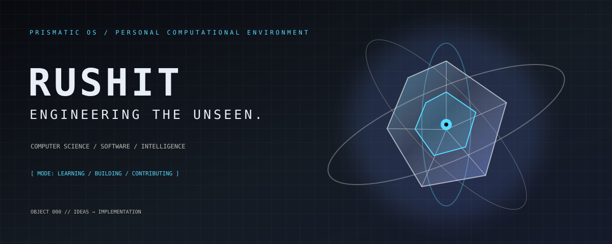
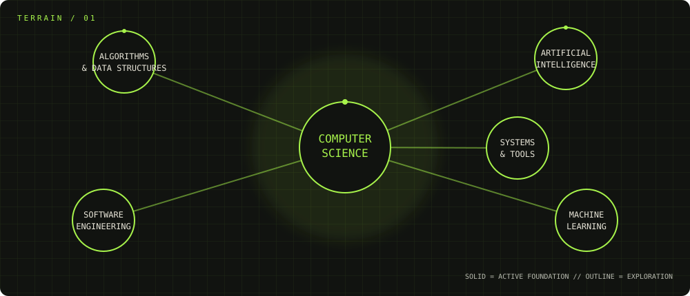

 

`[ PRISMATIC OS ]` &nbsp; ` [ OPERATOR: RUSHIT ] ` &nbsp; ` [ STATUS: EVOLVING ] `

### ENGINEERING THE UNSEEN.

Computer Science Engineering student exploring **C++, Python, algorithms, AI/ML, software engineering, and open source**.

> A personal developer universe where ideas become interfaces, experiments become artifacts, and the learning process stays visible.

## `01 // THE OPERATOR`

I’m **Rushit**, a Computer Science Engineering student building the habits behind exceptional software: understand the problem, make the system legible, and iterate until the idea works in the real world.

My current coordinates:

- **Foundation:** C++, Python, data structures, algorithms
- **Exploration:** AI/ML, data science, software architecture, full-stack development
- **Direction:** practical projects, open-source contribution, production-quality thinking

## `02 // COGNITIVE MAP`

## `03 // ENGINEERING ARTIFACTS`

Project slots remain explicit until real repositories are available. Replace only with verified details.

| Artifact | Purpose | Stack | Status |
|---|---|---|---|
| `{{PROJECT_NAME_01}}` | `{{PROJECT_DESCRIPTION_01}}` | `{{LANGUAGE_AND_TOOLS_01}}` | `{{STATUS_01}}` |
| `{{PROJECT_NAME_02}}` | `{{PROJECT_DESCRIPTION_02}}` | `{{LANGUAGE_AND_TOOLS_02}}` | `{{STATUS_02}}` |

## `04 // SYSTEM EVOLUTION`

  

Telemetry is read from public GitHub data. If an external card fails, the linked profile and native contribution calendar remain the source of truth.

## `05 // TRANSMISSION PORT`

<a href="https://github.com/rushitthumar42-pixel">`GITHUB / ARCHIVE`</a> &nbsp; · &nbsp;
<a href="{{LINKEDIN_URL}}">`LINKEDIN / PROFESSIONAL`</a> &nbsp; · &nbsp;
<a href="mailto:{{EMAIL_ADDRESS}}">`EMAIL / DIRECT`</a> &nbsp; · &nbsp;
<a href="{{PORTFOLIO_URL}}">`PORTFOLIO / LIVE INTERFACE`</a>

  

`PRISMATIC OS // THE SYSTEM IS EVOLVING`

<!-- Replace {{PORTFOLIO_URL}}, {{LINKEDIN_URL}}, {{EMAIL_ADDRESS}}, and project placeholders. -->
