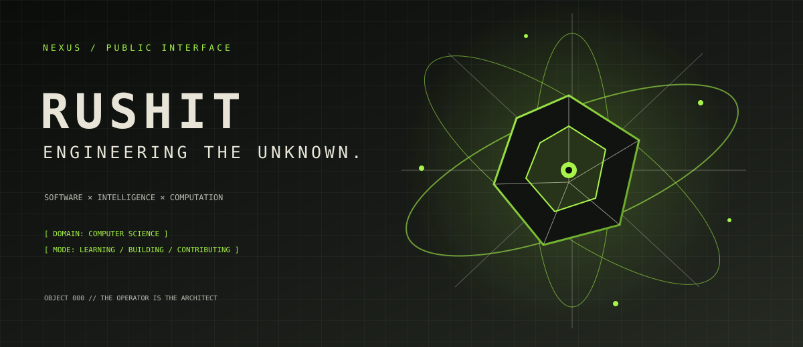
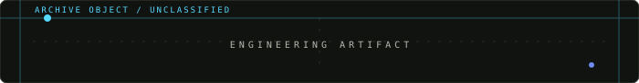
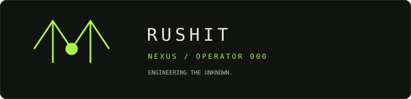

<div align="center">



<br />


<br />

`[ SYSTEM INITIALIZED ]` &nbsp; ` [ OPERATOR: RUSHIT ] ` &nbsp; ` [ STATUS: EVOLVING ] `

### ENGINEERING THE UNKNOWN.

Computer Science Engineering student building toward the intersection of **software engineering, artificial intelligence, algorithms, and computational systems**.

<a href="https://github.com/rushitthumar42-pixel"></a>
<a href="{{LINKEDIN_URL}}"></a>
<a href="mailto:{{EMAIL_ADDRESS}}"></a>

</div>

<br />

> **NEXUS** is a public-facing interface for an evolving computational research environment.  
> The operator is real. The system language is fiction. The work is the proof.

<table>
<tr>
<td width="50%" valign="top">

## `CHAPTER 00 / BOOT SEQUENCE`

```text
NEXUS // PUBLIC INTERFACE
────────────────────────
OPERATOR   :: Rushit
ROLE       :: CSE student
DOMAIN     :: software / intelligence / computation
ENVIRONMENT:: open source

INPUT      :: curiosity
PROCESS    :: learn -> build -> test -> contribute
OUTPUT     :: useful systems, one iteration at a time

FOCUS      :: C++ / Python / DSA / AI-ML
MODE       :: LEARNING + BUILDING + CONTRIBUTING
STATUS     :: EVOLVING
```

</td>
<td width="50%" valign="top">

### `OPERATOR NOTE`

I am building the fundamentals required to become an exceptional software engineer: rigorous problem solving, practical implementation, and the habit of making ideas real.

Current trajectory:

- learn algorithms deeply, not just syntactically;
- use **C++** and **Python** to turn reasoning into software;
- explore AI/ML and data science through practical experiments;
- understand how production-quality projects are designed and maintained;
- contribute to open source and learn from real codebases.

</td>
</tr>
</table>


## `CHAPTER 01 / COGNITIVE TERRAIN`

The map below is a topology of interests, not a claim of mastery. Solid nodes are active foundations; outlined nodes are directions under exploration.

<div align="center">

</div>

<table>
<tr>
<td width="50%" valign="top">

### ACTIVE FOUNDATION

`C++` &nbsp; `PYTHON` &nbsp; `DATA STRUCTURES` &nbsp; `ALGORITHMS`

</td>
<td width="50%" valign="top">

### EXPLORATION VECTOR

`AI / ML` &nbsp; `DATA SCIENCE` &nbsp; `FULL STACK` &nbsp; `OPEN SOURCE`

</td>
</tr>
</table>


## `CHAPTER 02 / ENGINEERING ARTIFACTS`

The archive is intentionally honest: replace each editable slot with a real repository when it exists. No fictional projects, metrics, or deployments are presented as completed work.

<table>
<tr>
<td width="50%" valign="top">



### `ARTIFACT // 01`
## `{{PROJECT_NAME_01}}`

**Purpose** — `{{TECHNICAL_PURPOSE_01}}`  
**Stack** — `{{LANGUAGES_AND_TOOLS_01}}`  
**Status** — `{{STATUS_01}}`

<a href="https://github.com/rushitthumar42-pixel/{{PROJECT_REPOSITORY_01}}">`OPEN RESEARCH RECORD →`</a>

</td>
<td width="50%" valign="top">


### `ARTIFACT // 02`
## `{{PROJECT_NAME_02}}`

**Purpose** — `{{TECHNICAL_PURPOSE_02}}`  
**Stack** — `{{LANGUAGES_AND_TOOLS_02}}`  
**Status** — `{{STATUS_02}}`

<a href="https://github.com/rushitthumar42-pixel/{{PROJECT_REPOSITORY_02}}">`OPEN RESEARCH RECORD →`</a>

</td>
</tr>
</table>

<details>
<summary><strong>ARCHIVE EXPANSION // Add more verified artifacts</strong></summary>
<br />

Duplicate an artifact block only for projects that actually exist. Include a working repository link, accurate technologies, and a status such as `EXPERIMENTAL`, `IN PROGRESS`, or `MAINTAINED`.

</details>


## `CHAPTER 03 / COMPUTATIONAL DNA`

<table>
<tr>
<td width="25%" valign="top">

### LANGUAGES

`C++`  
`Python`

</td>
<td width="25%" valign="top">

### ENGINEERING TOOLS

`Git`  
`GitHub`  
`{{TOOLS_TO_ADD}}`

</td>
<td width="25%" valign="top">

### DATA SYSTEMS

`{{DATA_TOOLS_TO_ADD}}`

</td>
<td width="25%" valign="top">

### AI / INTELLIGENCE

`AI / ML`  
`Data Science`

</td>
</tr>
</table>

> **CURRENTLY EXPLORING** — `{{FRAMEWORKS_OR_DATABASES_TO_ADD}}`  
> Add a technology only after using it in a real experiment or project. The archive values accuracy over logo density.


## `CHAPTER 04 / SYSTEM EVOLUTION`

These are external telemetry views of public GitHub activity. They are not fictional system metrics. If a provider becomes unavailable, the linked GitHub profile and native contribution calendar remain the source of truth.

<div align="center">

<a href="https://github.com/rushitthumar42-pixel"></a>
<a href="https://github.com/rushitthumar42-pixel"></a>

<br /><br />

<a href="https://github.com/rushitthumar42-pixel"></a>

</div>

<details>
<summary><strong>Telemetry configuration</strong></summary>
<br />

- The statistics cards use the actual profile username and read public GitHub data.
- The contribution calendar uses `ghchart.rshah.org`; remove it if it becomes unavailable.
- No private activity, follower counts, streak claims, or commit totals are hard-coded.
- Keep the native GitHub contribution calendar as the authoritative fallback.

</details>


## `CHAPTER 05 / TRANSMISSION PORT`

<div align="center">



### OPEN CHANNELS

<a href="https://github.com/rushitthumar42-pixel">`GITHUB / ARCHIVE`</a> &nbsp; · &nbsp;
<a href="{{LINKEDIN_URL}}">`LINKEDIN / PROFESSIONAL`</a> &nbsp; · &nbsp;
<a href="mailto:{{EMAIL_ADDRESS}}">`EMAIL / DIRECT`</a> &nbsp; · &nbsp;
<a href="{{PORTFOLIO_URL}}">`PORTFOLIO / FUTURE LINK`</a>

<br /><br />

`NEXUS // END OF CURRENT TRANSMISSION`

</div>

<!--
CUSTOMIZATION
1. Replace {{LINKEDIN_URL}}, {{EMAIL_ADDRESS}}, and {{PORTFOLIO_URL}}.
2. Replace project and technology placeholders only with verified information.
3. Keep the fictional NEXUS labels clearly separate from real telemetry.
-->
